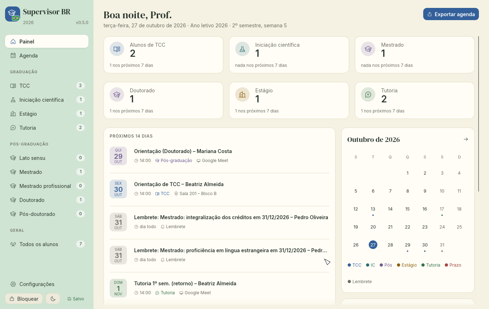
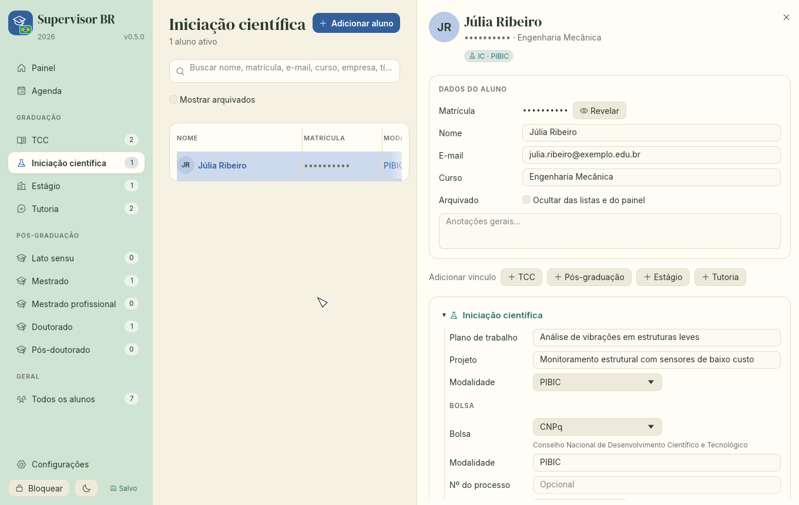
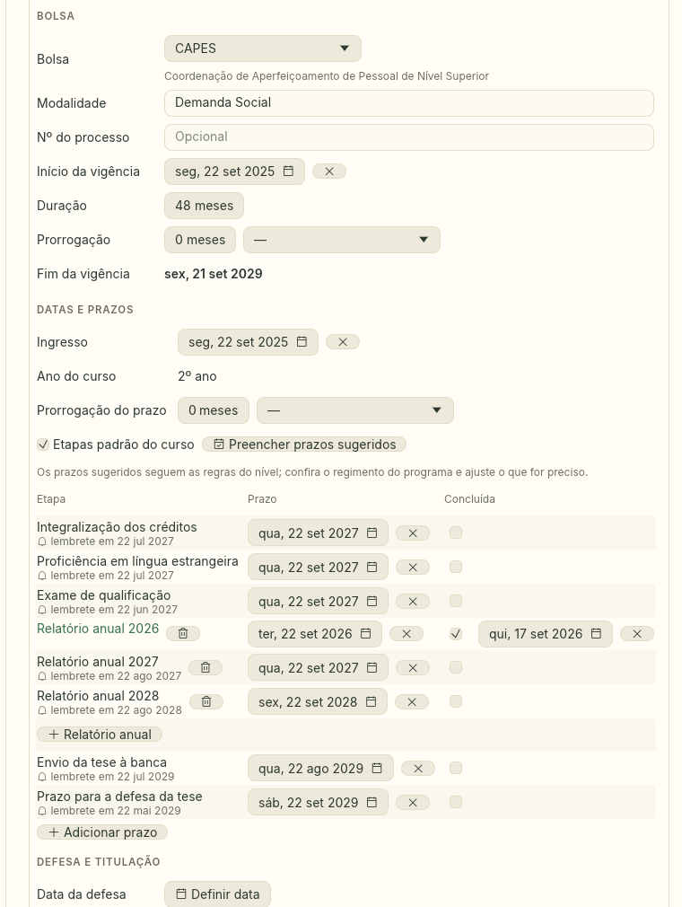
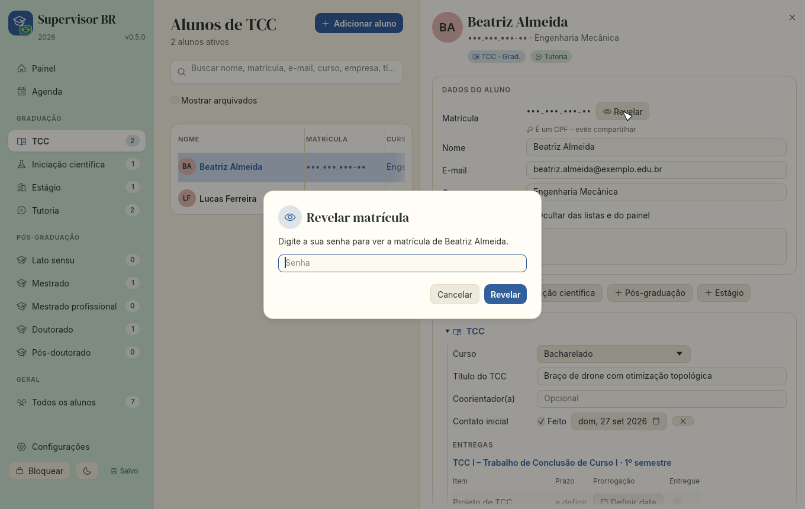
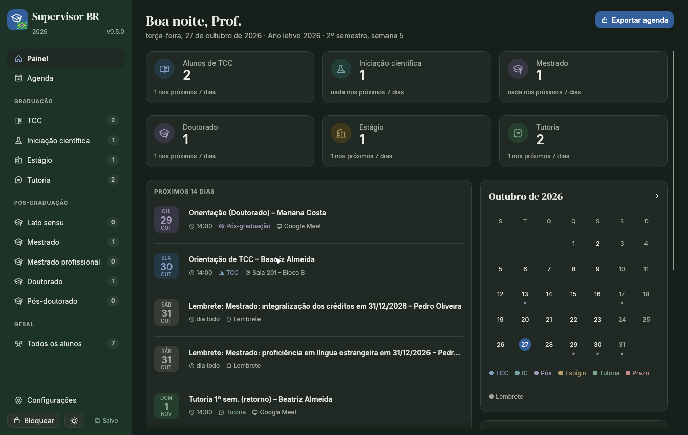

# Supervisor BR

Um aplicativo de desktop para professores de universidades brasileiras acompanharem seus orientandos: **TCC**, **iniciação científica**, **estágio supervisionado**, **tutoria** e **pós-graduação** (especialização, residência, mestrado acadêmico e profissional, doutorado e pós-doutorado). Funciona em Linux, Windows e macOS e guarda tudo em um único arquivo criptografado no seu computador.

É um fork do [Supervisor](https://github.com/g-machado-uu/supervisor), traduzido e adaptado à realidade brasileira: bolsas do CNPq, da CAPES e das FAPs, prazos de qualificação e defesa, e matrícula que muitas vezes é o próprio CPF. Desenvolvido com a ajuda do Claude Opus 5.5.



> Todos os nomes, e-mails e empresas das imagens são fictícios.

## O que ele faz

- **Painel**: o que vem pela frente nos próximos dias e o que precisa de atenção (aluno sem contato inicial, entrega atrasada, prazo de qualificação chegando, bolsa perto do fim).
- **Listas** para cada grupo de alunos. Clique em um aluno para abrir os detalhes à direita. Um mesmo aluno pode ter vários vínculos (por exemplo, TCC e iniciação científica).
- **Reuniões** avulsas ou recorrentes, on-line (Google Meet, Microsoft Teams, Zoom ou RNP, com o link) ou presenciais. Marque cada semana como realizada, cancelada ou remarcada.
- **Agenda** em lista ou em grade mensal. Exporte qualquer item para um arquivo `.ics` (Google Agenda, Outlook) ou salve o convite de uma reunião para enviar ao aluno.

### Graduação

- **TCC**: cursos e disciplinas (TCC I, TCC II…) configuráveis, com as entregas de cada uma, prazos por semana letiva ou data fixa, prorrogação por aluno, e a defesa com banca, local e nota.
- **Iniciação científica**: plano de trabalho, projeto, modalidade (PIBIC, PIBITI, PIBIC-Af, PIBIC-EM, voluntária, institucional), bolsa e os prazos do ciclo: relatório parcial, relatório final e apresentação no seminário/congresso de IC.
- **Estágio supervisionado**: concedente, estágio obrigatório ou não, vigência do Termo de Compromisso de Estágio (Lei 11.788/2008), relatório e visitas de acompanhamento.
- **Tutoria acadêmica**: reuniões de acompanhamento por semestre.



### Pós-graduação

- **Lato sensu**: especialização (incluindo MBA) e residência.
- **Stricto sensu**: mestrado acadêmico, mestrado profissional, doutorado acadêmico e doutorado profissional.
- **Pós-doutorado**.
- Para cada aluno: programa, situação, coorientação (inclusive de alunos de outros programas ou instituições), bolsa, etapas com prazo e lembrete, banca, resultado da defesa, versão final e data da titulação.
- **Preencher prazos sugeridos** calcula, a partir da data de ingresso, os prazos de integralização dos créditos, proficiência em língua estrangeira, exame de qualificação, relatórios anuais, envio do trabalho à banca e defesa. Datas já preenchidas não são alteradas.
- Você pode desligar as etapas padrão e cadastrar apenas os prazos do regimento do programa do aluno, cada um com o seu lembrete.



### Bolsas e agências de fomento

A bolsa de cada aluno (IC ou pós) registra a agência, a modalidade, o número do processo, o início, a duração, a prorrogação e o motivo dela. O fim da vigência é calculado e o painel avisa 90 dias antes.

Agências na lista:

- **Federais**: CNPq, CAPES, FINEP, PRH-ANP, MEC (PET, residências) e Ministério da Saúde (residências).
- **Estaduais**: as fundações de amparo à pesquisa dos 26 estados e do Distrito Federal, como FAPESP, FAPEMIG, FAPERJ, FACEPE, FAPESB, FAPERGS, Fundação Araucária, FAPDF, FUNCAP e FAPEAM.
- **Outras**: bolsa institucional, empresa ou outra fonte (com o nome à sua escolha).

### Prazos sugeridos

Os prazos padrão de cada nível ficam em **Configurações › Prazos da pós-graduação**, em meses a partir do ingresso, e podem ser alterados para seguir o regimento do seu programa:

| Nível                  | Créditos | Proficiência | Qualificação | Defesa |
| ---------------------- | -------: | -----------: | -----------: | -----: |
| Especialização         |       12 |            – |            – |     18 |
| Residência             |        – |            – |            – |     24 |
| Mestrado acadêmico     |       12 |           12 |           12 |     24 |
| Mestrado profissional  |       12 |           12 |           15 |     24 |
| Doutorado acadêmico    |       24 |           24 |           24 |     48 |
| Doutorado profissional |       24 |           24 |           30 |     48 |
| Pós-doutorado          |        – |            – |            – |     12 |

De onde vêm esses números:

- **Duração das bolsas de pós**: até 24 meses no mestrado e 48 no doutorado (Portaria CAPES nº 76/2010, art. 10, do programa de Demanda Social, e normas equivalentes do CNPq). O prazo de defesa sugerido coincide com o fim da bolsa.
- **Iniciação científica**: ciclo de 12 meses com relatório parcial, relatório final e apresentação em evento de IC (RN-017/2006 do CNPq, que rege o PIBIC e o PIBITI).
- **Prorrogação**: cada aluno tem um campo de prorrogação, em meses, com o motivo: licença-maternidade/paternidade ou adoção (Lei 14.925/2024 garante a prorrogação dos prazos acadêmicos e da bolsa), saúde, decisão do colegiado ou outro. O app mostra a nova data e pergunta se você quer usá-la.

As regras variam entre programas e mudam com o tempo. Os prazos sugeridos são um ponto de partida: confira o regimento do programa e o termo de outorga da bolsa e ajuste o que for preciso.

## Privacidade: matrícula e CPF

Em muitas instituições a matrícula é o próprio CPF do aluno. Por isso:

- A matrícula aparece **mascarada** (`•••.•••.•••-••`) nas listas e nos detalhes do aluno. Para vê-la, clique em **Revelar**; ela volta a ficar oculta quando você muda de aluno.
- Em **Configurações › Privacidade** você pode pedir que o app **solicite a sua senha** antes de revelar a matrícula, ou desligar o mascaramento.
- Quando a matrícula é um CPF válido, o app avisa para evitar compartilhá-la. A busca encontra o aluno pelo CPF com ou sem pontuação.



## Seus dados

- Tudo fica em **um único arquivo criptografado** (Argon2id + XChaCha20-Poly1305), protegido pela sua senha. O app salva sozinho e guarda uma cópia de segurança (`.bak`) do arquivo como estava quando você o desbloqueou.
- **Salvar agora**: clique em _Salvo_ no rodapé da barra lateral ou use `Ctrl+S`. A cópia `.bak` passa a ser essa versão.
- **Não existe recuperação de senha.** Guarde a senha e faça cópias do arquivo.
- Senhas novas precisam ter **pelo menos 12 caracteres**. Uma frase curta que você lembre funciona bem.
- Local padrão:
  - Linux: `~/.local/share/supervisor-br/data.svt`
  - Windows: `%APPDATA%\Supervisor-BR\data\data.svt`
  - macOS: `~/Library/Application Support/Supervisor-BR/data.svt`

  Na tela de desbloqueio você pode abrir ou criar um arquivo em outro lugar (por exemplo, numa pasta sincronizada).

- **Bloquear** (rodapé da barra lateral ou `Ctrl+L`) salva e fecha os dados; para abrir de novo é preciso a senha. O app também se bloqueia sozinho depois de **10 minutos** sem uso (ajuste em Configurações › Segurança).
- Se não for possível salvar (um drive de rede desconectado, por exemplo), o app avisa e não bloqueia nem fecha até salvar, a menos que você escolha descartar as alterações.
- Um arquivo de dados só pode estar aberto em uma janela por vez. Se ele for alterado em outro lugar (outro computador que compartilha o arquivo), o app pergunta antes de substituir essa versão e a guarda como `.bak`.
- Os arquivos `.ics` exportados **não** são criptografados.

## Arquivo-chave (opcional)

Se o arquivo de dados fica numa pasta sincronizada ou compartilhada (OneDrive, Google Drive, Dropbox, drive de rede), você pode protegê-lo também com um **arquivo-chave**: um arquivo pequeno guardado em cada computador que você usa, nunca junto do arquivo de dados. Sem ele, uma cópia do arquivo de dados não abre, nem para quem descobrir a sua senha.

**Para ativar:** em Configurações › Arquivo-chave, digite a sua senha e clique em **Adicionar arquivo-chave…**. O app salva o arquivo-chave neste computador e pede que você salve uma cópia de segurança antes de ativá-lo. Guarde essa cópia em um lugar seguro: um pendrive, ou como anexo num gerenciador de senhas como KeePassXC ou Bitwarden.

**Em cada outro computador:** abra o arquivo de dados normalmente. O app avisa que falta o arquivo-chave; clique em **Importar arquivo-chave…** e escolha a sua cópia. Isso é feito uma vez por computador.

O arquivo-chave fica em:

| Sistema | Arquivo-chave                                 |
| ------- | --------------------------------------------- |
| Linux   | `~/.config/supervisor-br/key.bin`             |
| Windows | `%APPDATA%\Supervisor-BR\config\key.bin`      |
| macOS   | `~/Library/Preferences/Supervisor-BR/key.bin` |

- **Nunca guarde o arquivo-chave ou a cópia dele na mesma pasta do arquivo de dados.** Juntos, o arquivo-chave não protege nada.
- **Se você perder todas as cópias do arquivo-chave, os dados não abrem mais**, mesmo com a senha certa.
- Cópias do arquivo de dados feitas antes de ativar o arquivo-chave (backups antigos, histórico de versões da nuvem) continuam abrindo só com a senha.
- Para desativar, vá em Configurações › Arquivo-chave e clique em **Remover arquivo-chave**.

## Primeiros passos

1. Na primeira vez, crie uma senha.
2. Em **Configurações**, informe o ano letivo e o início das aulas de cada semestre. Cadastre os seus cursos de graduação e as disciplinas de TCC com as entregas.
3. Se o seu programa de pós tiver prazos diferentes, ajuste-os em **Configurações › Prazos da pós-graduação**.
4. Adicione alunos com **Adicionar aluno** (`Ctrl+N`) e complete os dados no painel de detalhes.



## Instalação

### Binários prontos

Baixe o arquivo do seu sistema na página de [Releases](https://github.com/g-machado-uu/supervisor-br/releases) e confira-o com o `SHA256SUMS.txt`.

- **Linux**: `chmod +x supervisor-br-linux && ./supervisor-br-linux`. Precisa de `libxkbcommon` e `libwayland-client` (já presentes na maioria das distribuições com interface gráfica).
- **Windows**: execute `supervisor-br-windows.exe`. Se aparecer _"O Windows protegeu o computador"_, clique em _Mais informações_ → _Executar assim mesmo_. Se faltar `VCRUNTIME140.dll`, instale o [Visual C++ Redistributable](https://aka.ms/vc14/vc_redist.x64.exe).
- **macOS** (Apple Silicon): o binário não é assinado. Rode `xattr -d com.apple.quarantine supervisor-br-macos && chmod +x supervisor-br-macos` e depois `./supervisor-br-macos` no Terminal.

### A partir do código

É preciso o [Rust](https://rustup.rs) 1.95 ou mais recente.

**Linux** (no Debian/Ubuntu, instale antes `libxkbcommon-dev libwayland-dev`):

```sh
./install.sh                         # compila e instala para o seu usuário
./install.sh --path=~/Documentos/    # ...e guarda o arquivo de dados em ~/Documentos
./install.sh --uninstall             # remove o app (seus dados são mantidos)
```

Isso coloca `supervisor-br` em `~/.local/bin` e no menu de aplicativos, com o ícone.

**Windows**: instale o Rust pelo [rustup.rs](https://rustup.rs) (com o Visual Studio Build Tools, opção _Desenvolvimento para desktop com C++_), rode `cargo build --release` e copie `target\release\supervisor-br.exe` para um lugar fixo, como `%LOCALAPPDATA%\Programs\Supervisor-BR\`.

**macOS**: instale as ferramentas de desenvolvedor (`xcode-select --install`) e o Rust, e então:

```sh
cargo build --release
sudo cp target/release/supervisor-br /usr/local/bin/
```

Para atualizar, basta substituir o binário. Os dados ficam em outro lugar e não são afetados.

## Desenvolvimento

```sh
cargo test                                             # testes de unidade e da interface (headless)
SUPERVISOR_SHOTS=/alguma/pasta cargo test              # também salva screenshots
```

Os testes da interface percorrem todas as telas e painéis de detalhes em dois tamanhos de janela, nos modos claro e escuro, e falham se houver campo de texto pequeno demais ou widgets sobrepostos.

Enviar uma tag `v*` roda o `cargo audit` e os testes, compila os binários para Linux, Windows e macOS no GitHub Actions e publica uma release com eles e o `SHA256SUMS.txt`.
